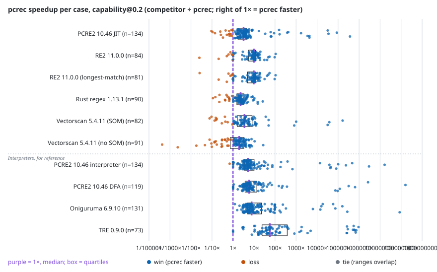
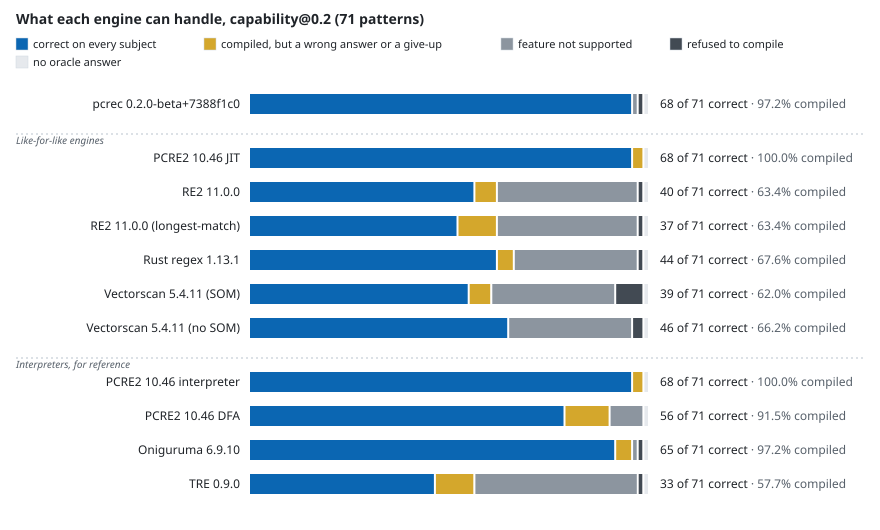

# pcrec-bench

pcrec-bench measures how fast regex engines really are on hard, realistic patterns: log parsing, input validation, security rules, backreferences, recursion, and inputs designed to make engines backtrack catastrophically. It compares [pcrec](https://github.com/fdicostanzo/pcrec), an ahead-of-time compiler that turns a regex into standalone C, against six widely used engines: PCRE2, RE2, Rust regex, Oniguruma, TRE and Vectorscan. A result only counts if the engine returned the correct answer, and compile time is reported separately rather than hidden.

## Headline

<!-- frontpage:headline:begin -->
**Latest run: pcrec was faster in 9 of 10 head-to-head comparisons (938 of 1,019), with a median speedup of 5.0×.**

On `capability@0.2` (142 pattern-regime cells), pcrec 0.2.0-beta+6b2dbd3e (config `pcrec-auto`, measured 2026-10-12) is faster in 938 of 1019 compared cases (92.1%), tied in 1 (0.1%) and slower in 80 (7.9%); a further 401 pairs have no verified number on one side and are excluded (counted below). Competitors: 10 configurations of 6 engines (libpcre2, oniguruma, re2, rust, tre, vectorscan). Match time, compile excluded.[^rate]

[^rate]: Win rate = wins / (wins + losses + ties) over all competitor × case pairs; a case is one (pattern, regime) cell where both engines produced a verified number; a tie is overlapping [min, max] trial ranges. Competitor records were measured 2026-10-08 to 2026-10-09, pcrec's on 2026-10-12, all on one machine (`budu-ryzen1600`).
<!-- frontpage:headline:end -->

<!-- frontpage:table:begin -->
| Competitor | Kind | Cases | pcrec wins | Losses | Ties | Median speedup | Geo-mean speedup | [Excluded](docs/methodology.md#excluded-cases-by-side-and-reason) |
|---|---|--:|--:|--:|--:|--:|--:|--:|
| PCRE2 10.46 JIT | JIT | 134 | 118 | 16 | 0 | ×3.18 | ×5.16 | 8 |
| RE2 11.0.0 | automata (lazy DFA, NFA fallback) | 84 | 76 | 8 | 0 | ×9.84 | ×7.00 | 58 |
| RE2 11.0.0 (longest-match) | automata (lazy DFA, NFA fallback) | 81 | 73 | 8 | 0 | ×9.68 | ×6.91 | 61 |
| Rust regex 1.13.1 | automata (lazy DFA, PikeVM, bounded backtracker) | 90 | 76 | 13 | 1 | ×2.29 | ×2.13 | 52 |
| Vectorscan 5.4.11 (SOM) | automata (SIMD multi-pattern) | 82 | 71 | 11 | 0 | ×3.54 | ×4.63 | 60 |
| Vectorscan 5.4.11 (no SOM) | automata (SIMD multi-pattern) | 91 | 68 | 23 | 0 | ×1.98 | ×1.24 | 51 |
| **Interpreters, for reference** |  |  |  |  |  |  |  |  |
| PCRE2 10.46 interpreter | interpreter (backtracking) | 134 | 133 | 1 | 0 | ×5.14 | ×12.9 | 8 |
| PCRE2 10.46 DFA | DFA | 119 | 119 | 0 | 0 | ×5.84 | ×13.6 | 23 |
| Oniguruma 6.9.10 | interpreter (backtracking) | 131 | 131 | 0 | 0 | ×7.53 | ×19.2 | 11 |
| TRE 0.9.0 | automata (POSIX tagged NFA; backtracking only for backreferences) | 73 | 73 | 0 | 0 | ×65.5 | ×210 | 69 |
| **all pairs** |  | 1019 | 938 | 80 | 1 | ×5.01 | ×8.52 |  |

Speedup = competitor median ÷ pcrec median, per case (> 1 means pcrec is faster); the median and geometric mean run over all of that engine's cases, ties included. Excluded cases are counted, never dropped silently; a pair failing on both sides is attributed to the pcrec side. The first group is the like-for-like engines, the second the interpreters, for reference (see Fairness below). The breakdown of the Excluded count by side and reason is in the [methodology](docs/methodology.md#excluded-cases-by-side-and-reason).
<!-- frontpage:table:end -->

<!-- frontpage:chart:begin -->

<!-- frontpage:chart:end -->

Each dot is one case (a pattern in one regime). Right of the dashed 1× line pcrec is faster. The box spans the quartiles of that engine's cases and the thick bar is the median.

## Pattern support

How many of the set's patterns each engine can compile, and whether the answers are right.

<!-- frontpage:supportchart:begin -->


One bar per engine, each the full set; speed is not capability. Exact counts are in the table below.
<!-- frontpage:supportchart:end -->

<!-- frontpage:support:begin -->
| Engine | Compiled | Unsupported feature | Refused to compile | Wrong answers | Correct on every subject |
|---|--:|--:|--:|--:|--:|
| pcrec 0.2.0-beta+6b2dbd3e | 69 (97.2%) | 1 | 1 | 0 | 68 of 68 (100.0%) |
| **Like-for-like engines** |  |  |  |  |  |
| PCRE2 10.46 JIT | 71 (100.0%) | 0 | 0 | 0 | 68 of 70 (97.1%) |
| RE2 11.0.0 | 45 (63.4%) | 25 | 1 | 4 | 40 of 44 (90.9%) |
| RE2 11.0.0 (longest-match) | 45 (63.4%) | 25 | 1 | 7 | 37 of 44 (84.1%) |
| Rust regex 1.13.1 | 48 (67.6%) | 22 | 1 | 3 | 44 of 47 (93.6%) |
| Vectorscan 5.4.11 (SOM) | 44 (62.0%) | 22 | 5 | 4 | 39 of 43 (90.7%) |
| Vectorscan 5.4.11 (no SOM) | 47 (66.2%) | 22 | 2 | 0 | 46 of 46 (100.0%) |
| **Interpreters, for reference** |  |  |  |  |  |
| PCRE2 10.46 interpreter | 71 (100.0%) | 0 | 0 | 0 | 68 of 70 (97.1%) |
| PCRE2 10.46 DFA | 65 (91.5%) | 6 | 0 | 5 | 56 of 64 (87.5%) |
| Oniguruma 6.9.10 | 69 (97.2%) | 1 | 1 | 0 | 65 of 68 (95.6%) |
| TRE 0.9.0 | 41 (57.7%) | 29 | 1 | 6 | 33 of 40 (82.5%) |

The set has 71 patterns; each counts once, however many regimes and forms it is measured in. *Compiled* means the engine accepted the pattern (the percentage is of all patterns); *Unsupported feature* is a pattern the engine declares it does not support; *Refused to compile* is one it declined or failed to build (for example a size limit). *Wrong answers* counts compiled patterns with at least one wrong answer against the oracle. *Correct on every subject* is out of the compiled patterns that have an oracle answer in every regime (1 pattern left out for having none, a gap in the set rather than an engine failure); a wrong answer or a give-up counts as not correct. RE2, Rust regex, Vectorscan and TRE decline features such as backreferences, recursion and lookaround by design, and this set deliberately includes such patterns: a lower figure is a design scope, not a defect. The leftmost-longest engines' different match semantics are covered in the [methodology](docs/methodology.md#engines) and also lower the *Correct on every subject* figure of RE2 (longest-match) and TRE.
<!-- frontpage:support:end -->

## Explore the full results

[**Results viewer**](https://fdicostanzo.github.io/pcrec-bench/) is a static page over every measured set, engine, pattern and regime in the store: pick engines and sets, choose a metric, and the matrix re-renders in the browser. Cell values come from the same reduction code that produced the tables on this page. The viewer is a reading aid; the records under `store/` are the canonical data.

## Where pcrec loses

Taken from the same comparison as the table above, worst first, with nothing filtered out. A cause is shown only where a committed ledger or notes file states one, quoted with its source; otherwise it says "cause not yet analysed".

Before pcrec's reverse-from-end search (pcrec 255bcdd8 and earlier) the largest losses were the end-anchored patterns added in capability@0.2 (`\w+\z`, `[a-z]+\.txt$`, `\s+$` and their kin over 1 MiB of prose): an engine that can start an end-anchored search from the end of the subject touches only the tail, and pcrec scanned forward over the whole megabyte. `[OPT-REVEND]` (pin 7388f1c0) removed that: the 15 tail cells went from 0.2-2.9 ms to 7.9-40.7 ns per call, the losing cases fell from 99 to 81 and the group carrying the tail cause from 17 to 2. The latest pin (b8337c33, `[START-LANDING]`) acts on forward-scan artifacts and leaves the tail family alone, which pcrec stated in advance (pcrec inbox I-146) and the window confirmed: re-measuring 7388f1c0 in the same window, all 132 per-subject tail cells of b8337c33 are within trial overlap of it, and the two tail losses below are unchanged. The losing cases moved from 81 to 80 (a Vectorscan no-SOM loss became a tie) and the wins from 936 to 937 (a PCRE2-interpreter tie became a win). What is left of the family is the two 61,440-byte bodies that match from byte 0 to the end, about 21.8 µs each, against Vectorscan's no-SOM configuration. **That comparison is not like for like** (pcrec inbox I-146): no-SOM reports only whether a match exists and never recovers where it starts, while pcrec's reverse walk is the price of the leftmost start. Read these two losses against Vectorscan SOM, the configuration that does report a start: there pcrec is faster on every tail cell, including both (set sums 21.9 µs against 22.3 ms for `tail-word-eoz` and 22.0 µs against 18.0 ms for `tail-space-eol`; on the two 61,440-byte bodies themselves 21.8 µs against 133 µs, about 6× faster; [docs/dev/ledgers/2026-10-11-start-landing-state3-b8337c33.md](docs/dev/ledgers/2026-10-11-start-landing-state3-b8337c33.md), section 7.3). The SOM records are from the 2026-10-08/09 window with no same-window control, so the claim rests on a gap of three orders of magnitude, not on a fine ratio. Competitor records on this page are from the 2026-10-08 window and pcrec's from 2026-10-11; the cross-window gap is dated in the footnote above.

<!-- frontpage:losses:begin -->
**2 of the losing cases share one documented cause:** "the tail family's remaining cost is the long MATCHING body, not the megabyte of non-matching text" ([docs/dev/ledgers/2026-10-10-opt-revend-states12-7388f1c0.md](docs/dev/ledgers/2026-10-10-opt-revend-states12-7388f1c0.md)). Worst: `tail-word-eoz` (large-subject-throughput) against Vectorscan 5.4.11 (no SOM), pcrec slower by ×55.6. Work item: [OPT-REVEND (implemented, pcrec 7388f1c0)](https://github.com/fdicostanzo/pcrec/tree/main/docs/dev/optloop/revend/).

Of 80 losing cases across all competitors (pcrec slower, trial ranges disjoint; "slower by" is pcrec median ÷ competitor median), 2 are summarised above; the 20 worst of the remaining 78 are listed here, grouped by pattern family, families ordered by their worst case. Vectorscan's `nosom` configuration reports only match or no match and its driver stops at the first match (testees/vectorscan/CLAUDE.md), so on a subject that matches it does less work than an engine that reports a span; read its rows with that in mind.

**semantics-divergence**

| Pattern | Regime | Engine | pcrec slower by | Why |
|---|---|---|--:|---|
| `wild-semdiv-empty-alt-repeat-pcre2` | large-subject-throughput | Vectorscan 5.4.11 (no SOM) | ×2,370 | cause not yet analysed |
| `keyword-prefix-order` | large-subject-throughput | Vectorscan 5.4.11 (no SOM) | ×429 | cause not yet analysed |
| `wild-semdiv-altorder-foo-foobar-rustregex` | large-subject-throughput | Rust regex 1.13.1 | ×6.89 | cause not yet analysed |

**wild-datetime**

| Pattern | Regime | Engine | pcrec slower by | Why |
|---|---|---|--:|---|
| `wild-datetime-moment-iso8601` | large-subject-throughput | RE2 11.0.0 | ×39.8 | cause not yet analysed |
| `wild-datetime-moment-iso8601` | large-subject-throughput | RE2 11.0.0 (longest-match) | ×38.9 | cause not yet analysed |
| `wild-datetime-moment-iso8601` | large-subject-throughput | PCRE2 10.46 JIT | ×10.7 | cause not yet analysed |

**wild-codegrammar**

| Pattern | Regime | Engine | pcrec slower by | Why |
|---|---|---|--:|---|
| `wild-codegrammar-json-constant` | large-subject-throughput | Vectorscan 5.4.11 (SOM) | ×13.0 | cause not yet analysed |
| `wild-codegrammar-json-constant` | large-subject-throughput | Vectorscan 5.4.11 (no SOM) | ×13.0 | cause not yet analysed |
| `wild-codegrammar-json-constant` | large-subject-throughput | Rust regex 1.13.1 | ×9.02 | cause not yet analysed |

**wild-validator**

| Pattern | Regime | Engine | pcrec slower by | Why |
|---|---|---|--:|---|
| `wild-validator-email-owasp` | large-subject-throughput | Vectorscan 5.4.11 (no SOM) | ×10.7 | cause not yet analysed |
| `wild-validator-email-owasp` | large-subject-throughput | Vectorscan 5.4.11 (SOM) | ×10.6 | cause not yet analysed |
| `wild-validator-email-owasp` | large-subject-throughput | PCRE2 10.46 JIT | ×7.22 | cause not yet analysed |

**wild-waf**

| Pattern | Regime | Engine | pcrec slower by | Why |
|---|---|---|--:|---|
| `wild-waf-crs-942360-concat-sqli` | large-subject-throughput | Vectorscan 5.4.11 (no SOM) | ×10.2 | cause not yet analysed |
| `wild-waf-crs-942270-union-select` | large-subject-throughput | PCRE2 10.46 JIT | ×9.49 | cause not yet analysed |
| `wild-waf-crs-942270-union-select` | large-subject-throughput | Vectorscan 5.4.11 (no SOM) | ×6.59 | cause not yet analysed |
| `wild-waf-crs-942270-union-select` | large-subject-throughput | Vectorscan 5.4.11 (SOM) | ×6.59 | cause not yet analysed |
| `wild-waf-crs-942360-concat-sqli` | large-subject-throughput | Vectorscan 5.4.11 (SOM) | ×6.36 | cause not yet analysed |

**binary-nonutf8**

| Pattern | Regime | Engine | pcrec slower by | Why |
|---|---|---|--:|---|
| `high-byte-run` | large-subject-throughput | Vectorscan 5.4.11 (SOM) | ×7.53 | cause not yet analysed |
| `high-byte-run` | large-subject-throughput | Vectorscan 5.4.11 (no SOM) | ×7.53 | cause not yet analysed |

**wild-logparse**

| Pattern | Regime | Engine | pcrec slower by | Why |
|---|---|---|--:|---|
| `hex8-bounded` | large-subject-throughput | Vectorscan 5.4.11 (no SOM) | ×7.46 | cause not yet analysed |

Losses by family, over every case:

| Family | Cases | Losses | Loss rate |
|---|--:|--:|--:|
| wild-waf | 95 | 20 | 21.1% |
| wild-datetime | 20 | 4 | 20.0% |
| semantics-divergence | 108 | 19 | 17.6% |
| binary-nonutf8 | 41 | 4 | 9.8% |
| wild-codegrammar | 112 | 9 | 8.0% |
| cap-lookaround | 32 | 2 | 6.2% |
| cap-backref | 35 | 2 | 5.7% |
| wild-secrets | 78 | 4 | 5.1% |
| wild-validator | 120 | 5 | 4.2% |
| wild-logparse | 235 | 8 | 3.4% |
| cap-recursion | 30 | 1 | 3.3% |
| redos-nested | 93 | 2 | 2.2% |
| floor | 20 | 0 | 0.0% |
<!-- frontpage:losses:end -->

<details>
<summary><strong>Second look: the other sets</strong> (click to expand)</summary>

The same metric, for the latest `pcrec-auto` record against each competitor's latest record on each other set in the store. Pin and date are shown per row because these records were not all measured in one window.

<!-- frontpage:othersets:begin -->
| Set | Competitor | pcrec-auto (pin, date) | Competitor date | Cases | Wins | Losses | Ties | Median speedup | Excluded |
|---|---|---|---|--:|--:|--:|--:|--:|---|
| `email-specimen@0.2` | PCRE2 10.46 interpreter | 6b2dbd3e (2026-10-13) | 2026-10-13 | 6 | 6 | 0 | 0 | ×17.6 | 3 (engine side: 3 not measured) |
| `email-specimen@0.2` | PCRE2 10.46 JIT | 6b2dbd3e (2026-10-13) | 2026-10-13 | 5 | 5 | 0 | 0 | ×2.87 | 4 (engine side: 4 not measured) |
| `email-specimen@0.2` | Rust regex 1.13.1 | 6b2dbd3e (2026-10-13) | 2026-09-20 | 6 | 5 | 1 | 0 | ×1.82 | 3 (engine side: 3 unsupported or refused) |
| `loglines@0.1` | PCRE2 10.46 interpreter | 6b2dbd3e (2026-10-12) | 2026-10-13 | 22 | 22 | 0 | 0 | ×11.9 | 0 |
| `loglines@0.1` | PCRE2 10.46 JIT | 6b2dbd3e (2026-10-12) | 2026-10-13 | 22 | 18 | 3 | 1 | ×1.70 | 0 |
| `loglines@0.1` | Rust regex 1.13.1 | 6b2dbd3e (2026-10-12) | 2026-09-20 | 22 | 16 | 6 | 0 | ×2.75 | 0 |
| `bounded@0.3` | PCRE2 10.46 interpreter | 6b2dbd3e (2026-10-13) | 2026-10-13 | 84 | 84 | 0 | 0 | ×6.25 | 45 (pcrec side: 3 unsupported or refused; engine side: 42 not measured) |
| `bounded@0.3` | PCRE2 10.46 JIT | 6b2dbd3e (2026-10-13) | 2026-10-13 | 84 | 70 | 14 | 0 | ×2.55 | 45 (pcrec side: 3 unsupported or refused; engine side: 42 not measured) |
| `bounded@0.3` | Rust regex 1.13.1 | 6b2dbd3e (2026-10-13) | 2026-09-20 | 120 | 111 | 8 | 1 | ×5.80 | 9 (pcrec side: 3 unsupported or refused; engine side: 6 unsupported or refused) |
| `altwide@0.3` | PCRE2 10.46 JIT | 6b2dbd3e (2026-10-12) | 2026-10-02 | 68 | 68 | 0 | 0 | ×59.5 | 49 (pcrec side: 10 unsupported or refused; engine side: 39 not measured) |
| `altwide@0.3` | Rust regex 1.13.1 | 6b2dbd3e (2026-10-12) | 2026-10-02 | 107 | 80 | 25 | 2 | ×1.44 | 10 (pcrec side: 10 unsupported or refused) |
| `syntax@0.1` | PCRE2 10.46 interpreter | 6b2dbd3e (2026-10-13) | 2026-10-13 | 163 | 163 | 0 | 0 | ×5.33 | 109 (pcrec side: 2 wrong answer, 3 gave up, 24 unsupported or refused; engine side: 80 not measured) |
| `syntax@0.1` | PCRE2 10.46 JIT | 6b2dbd3e (2026-10-13) | 2026-10-13 | 163 | 115 | 48 | 0 | ×2.53 | 109 (pcrec side: 2 wrong answer, 3 gave up, 24 unsupported or refused; engine side: 80 not measured) |
| `syntax@0.1` | Rust regex 1.13.1 | 6b2dbd3e (2026-10-13) | 2026-09-20 | 130 | 106 | 23 | 1 | ×2.14 | 142 (pcrec side: 2 wrong answer, 3 gave up, 24 unsupported or refused; engine side: 17 wrong answer, 96 unsupported or refused) |
| `utf8@0.1` | PCRE2 10.46 DFA UTF-8 | 6b2dbd3e (2026-10-13) | 2026-09-26 | 137 | 137 | 0 | 0 | ×7.75 | 13 (pcrec side: 12 unsupported or refused; engine side: 1 wrong answer) |
| `utf8@0.1` | PCRE2 10.46 interpreter UTF-8 | 6b2dbd3e (2026-10-13) | 2026-10-13 | 138 | 138 | 0 | 0 | ×7.72 | 12 (pcrec side: 12 unsupported or refused) |
| `utf8@0.1` | PCRE2 10.46 JIT UTF-8 | 6b2dbd3e (2026-10-13) | 2026-10-13 | 138 | 138 | 0 | 0 | ×4.88 | 12 (pcrec side: 12 unsupported or refused) |
| `utf8@0.1` | Oniguruma 6.9.10 UTF-8 | 6b2dbd3e (2026-10-13) | 2026-09-26 | 119 | 119 | 0 | 0 | ×12.7 | 31 (pcrec side: 12 unsupported or refused; engine side: 5 wrong answer, 14 unsupported or refused) |
| `utf8@0.1` | RE2 11.0.0 UTF-8 | 6b2dbd3e (2026-10-13) | 2026-09-26 | 122 | 119 | 3 | 0 | ×9.63 | 28 (pcrec side: 12 unsupported or refused; engine side: 6 wrong answer, 10 unsupported or refused) |
| `utf8@0.1` | Rust regex 1.13.1 | 6b2dbd3e (2026-10-13) | 2026-09-26 | 114 | 93 | 21 | 0 | ×2.69 | 36 (pcrec side: 12 unsupported or refused; engine side: 4 wrong answer, 20 unsupported or refused) |
| `utf8@0.1` | Vectorscan 5.4.11 (no SOM) UTF-8 | 6b2dbd3e (2026-10-13) | 2026-09-26 | 126 | 76 | 49 | 1 | ×1.55 | 24 (pcrec side: 12 unsupported or refused; engine side: 2 wrong answer, 10 unsupported or refused) |
| `litrun@0.1` | PCRE2 10.46 interpreter | 6b2dbd3e (2026-10-12) | 2026-10-13 | 28 | 28 | 0 | 0 | ×4.32 | 14 (engine side: 14 not measured) |
| `litrun@0.1` | PCRE2 10.46 JIT | 6b2dbd3e (2026-10-12) | 2026-10-13 | 28 | 21 | 7 | 0 | ×2.13 | 14 (engine side: 14 not measured) |

- `email-specimen@0.2`: competitors measured: libpcre2, rust.
- `loglines@0.1`: competitors measured: libpcre2, rust.
- `bounded@0.3`: competitors measured: libpcre2, rust.
- `altwide@0.3`: competitors measured: libpcre2, rust.
- `syntax@0.1`: competitors measured: libpcre2, rust.
- `utf8@0.1`: competitors measured: libpcre2, oniguruma, re2, rust, vectorscan.
- `litrun@0.1`: competitors measured: libpcre2.
<!-- frontpage:othersets:end -->

</details>

## Methodology

Short version; the full text, with the engine, hardware and compile-cost tables, is in [docs/methodology.md](docs/methodology.md).

- **What is timed.** Match time and compile time are separate axes. The headline is match time with compile excluded. Compile cost is reported separately in [docs/methodology.md](docs/methodology.md#compile-cost), and for pcrec it is large because compiling runs a C compiler.
- **Cases.** One case is one pattern in one regime (short-subject search, large-subject throughput), reduced over every subject of that regime. The set-grain arithmetic is `pcrecbench/reduce.py`, shared with the reporter.
- **Trials.** Five trials per cell, median with min and max. A tie means the two engines' min-max trial ranges overlap. Records are produced only after a quiet-box pre-flight and a trial-agreement check.
- **Correctness.** Every expected answer comes from libpcre2 as the oracle. A cell where an engine answers wrongly, gives up, or does not support the pattern gets no number: it is left out of the comparison and counted in the Excluded column.
- **Semantics differ by engine.** RE2 in `longest` mode and TRE are leftmost-longest (TRE is POSIX), Vectorscan in its `nosom` configuration reports only match or no match. Their expectations and caveats are in the methodology page.

### Fairness

Ahead-of-time compilation has an inherent advantage on these numbers. pcrec turns a pattern that is known before the program runs into C that a C compiler then optimises with the pattern's structure fixed; an engine that receives its pattern at runtime cannot specialise that far. Because the headline excludes compile time, that specialisation counts in pcrec's favour, and the cost of getting it (a C compiler run per pattern) is shown separately in the [compile-cost table](docs/methodology.md#compile-cost), where pcrec is the slowest engine in the table by a wide margin.

The closest like-for-like rows are the engines that also build a specialised matcher before matching: PCRE2 JIT, which emits machine code at runtime, and RE2, Rust `regex` and Vectorscan, which build automata at runtime. The interpreters (PCRE2's interpreter and DFA matcher, Oniguruma, TRE) are in the table for reference; pcrec's margin over them is the larger and less informative one.

## Reproduce

```sh
python3 -m venv .venv && .venv/bin/pip install -r requirements.txt
python3 -m pcrecbench testees                                  # configured engines
python3 -m pcrecbench run --subbench capability --testee pcre2-jit --trials 5
python3 -m pcrecbench index
make frontpage      # regenerate this page's tables, chart and provenance from store/
make viewer-data    # regenerate the viewer's data files
```

Engine build prerequisites are listed by `make deps`. Every number on this page is listed with its source record in [docs/frontpage_provenance.tsv](docs/frontpage_provenance.tsv).

## Status

pcrec is at 0.2.0-beta; the pinned commit measured here is main after that tag, not a release. Optimization work on pcrec is ongoing and driven by this benchmark, so results change. This page shows the latest run only.

## How it was built

pcrec-bench was built by directed AI agents (Claude) as a sibling project of pcrec; see pcrec's [APPROACH.md](https://github.com/fdicostanzo/pcrec/blob/main/APPROACH.md). The design record is in [APPROACH.md](APPROACH.md) and `docs/`.

License: MIT ([LICENSE](LICENSE)).
